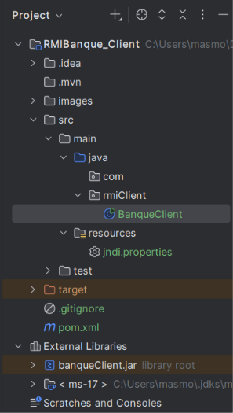
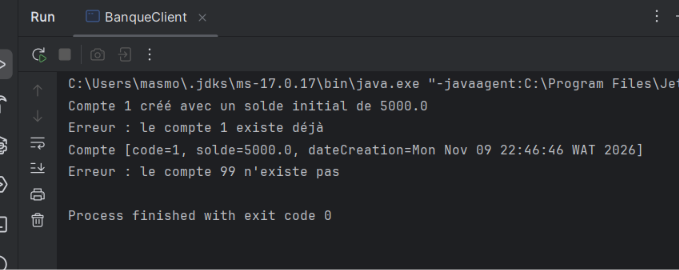
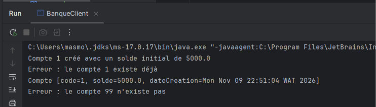

# RMIBanque_Client

**TP5 – Activité 5-2 : Service de banque avec Java RMI et JNDI**

Projet **client** : il crée et consulte des comptes bancaires sur le serveur `RMIBanque_Server` via RMI.
Il ne contient **aucune classe du serveur** : il utilise uniquement `IBanque` et `Compte`, fournis par `banqueClient.jar`.


## Prérequis
- `banqueClient.jar` (généré depuis le projet serveur) ajouté au classpath du projet :
  IntelliJ → File → Project Structure → Modules → Dependencies → + → JARs or Directories.
- Le serveur doit être démarré avant le client.

## jndi.properties
```
java.naming.factory.initial=com.sun.jndi.rmi.registry.RegistryContextFactory
java.naming.provider.url=rmi://localhost:1099
```

## Imprimés écran

### Étape 3 – Développement du client : structure du projet et jar dans le classpath


### Étape 4 – Exécution avec le registre RMI direct (`Naming.lookup`)


### Étape 5 – Exécution avec JNDI (`InitialContext.lookup`)


## Exécution
1. Lancer `rmiServer.BanqueServer` (projet serveur).
2. Lancer `rmiClient.BanqueClient`.

